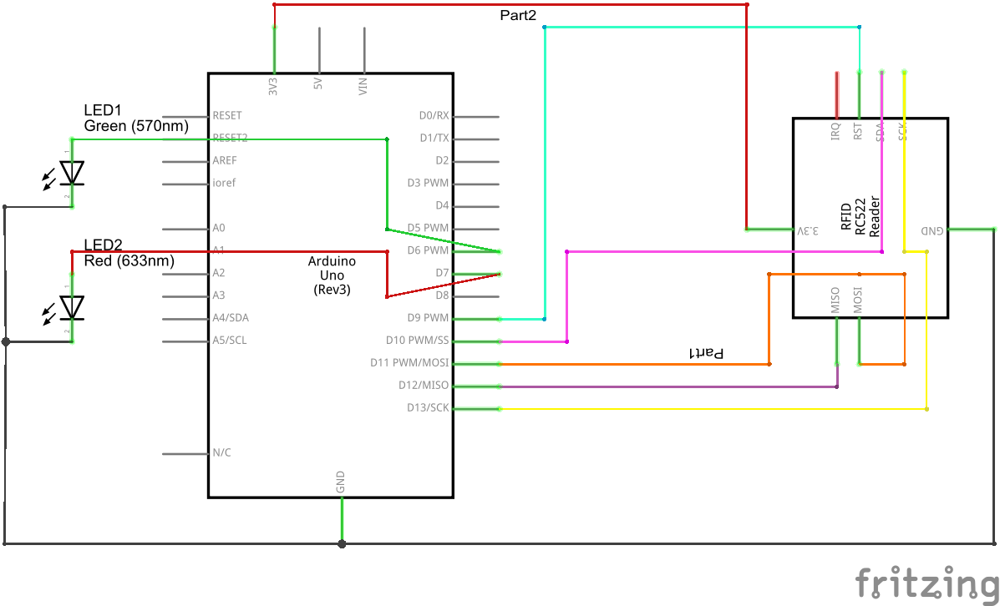

# ESP32-Smart-EVM — IoT Electronic Voting Machine with Cloud Sync

> An IoT-enabled Electronic Voting Machine (EVM) built on the ESP32 microcontroller with realtime cryptographic cloud tallying via Firebase Realtime Database.

This project delivers a tamper-evident, connected voting terminal designed for campus elections, organizational polls, and smart governance prototypes. It combines hardware-level button debouncing, acoustic buzzer feedback, a hardware coalition logic detection interface, and instant cloud vote synchronization.



---

## Features

- **4-Candidate Ballot Array:** Dedicated tactile buttons wired with internal pull-up/pull-down logic for reliable input capture.
- **Realtime Cloud Synchronization:** Transmits every validated vote directly to Google Firebase Realtime Database over secure Wi-Fi using the `Firebase_ESP_Client` library.
- **Hardware Coalition & Alliance Tracking:** Integrated digital input (GPIO 33) driven by hardware logic (OR gate / diode matrix) or algorithmic cloud tallying for multi-party coalitions.
- **Auditory Confirmation:** Integrated active buzzer (GPIO 25) generates a high-frequency feedback beep upon each valid vote entry, alerting polling agents and the voter.
- **Software Anti-Bounce Protection:** Built-in 300 ms debounce filter prevents double-press vote duplication and hardware contact jitter.
- **Auto-Reconnect & Fault Resilience:** Automated Wi-Fi and Firebase keep-alive reconnection routines to maintain operational continuity even during intermittent network drops.

---

## Hardware Pinout & Wiring

| Component | ESP32 GPIO | Pin Mode | Description |
|---|---|---|---|
| **Button 1** (Candidate A) | `GPIO 13` | `INPUT_PULLUP` | Tactile switch to GND |
| **Button 2** (Candidate B) | `GPIO 14` | `INPUT_PULLUP` | Tactile switch to GND |
| **Button 3** (Candidate C) | `GPIO 27` | `INPUT_PULLUP` | Tactile switch to GND |
| **Button 4** (Candidate D) | `GPIO 26` | `INPUT_PULLUP` | Tactile switch to GND |
| **Coalition Input** | `GPIO 33` | `INPUT` | Driven by external logic / OR gate array |
| **Feedback Buzzer** | `GPIO 25` | `OUTPUT` | Active buzzer positive lead (GND to rail) |

Refer to [`docs/schematic.png`](docs/schematic.png) for the complete breadboard & PCB wiring diagram.

---

## Firebase Realtime Database Schema

```json
{
  "votes": {
    "Candidate_A": 42,
    "Candidate_B": 38,
    "Candidate_C": 19,
    "Candidate_D": 25,
    "Coalition_A_B": 80
  }
}
```

---

## Getting Started

### Required Libraries
Install the following libraries in Arduino IDE (**Tools** → **Manage Libraries...**):
- **Firebase ESP Client** by Mobizt (`Firebase_ESP_Client`)
- **WiFi** (built into the ESP32 Arduino Core)

### Configuration

Open `esp32_smart_evm.ino` and configure your local Wi-Fi and Firebase credentials:

```cpp
// =================== Wi-Fi ===================
const char* ssid = "YOUR_WIFI_SSID";
const char* password = "YOUR_WIFI_PASSWORD";

// =================== Firebase ===================
#define FIREBASE_HOST "your-project-default-rtdb.firebaseio.com"
#define FIREBASE_AUTH "YOUR_FIREBASE_DATABASE_SECRET"
```

Customize the candidate ballot labels as desired:
```cpp
const char* buttonNames[4] = {
  "Candidate_A",
  "Candidate_B",
  "Candidate_C",
  "Candidate_D"
};
```

### Flashing Procedure

1. Connect your ESP32 Development Board via Micro-USB / USB-C.
2. In Arduino IDE:
   - Select **Tools** → **Board** → **ESP32 Arduino** → **ESP32 Dev Module**.
   - Select the corresponding COM port (**Tools** → **Port**).
   - Set Upload Speed to `921600` or `115200`.
3. Click **Upload** (or `Ctrl + U`).
4. Open the Serial Monitor at **115200 baud** to observe Wi-Fi connection and vote event logs.

---

## Security & Reliability Notes

- **Never commit live Wi-Fi passwords or Firebase Database secrets** to public repositories.
- For production elections, migrate from Firebase legacy database tokens to Firebase Authentication (OAuth2 / Service Account JSON) with strict read/write security rules.
- Hardware enclosure should enclose all GPIO lines to prevent physical line tampering.

---

## License

MIT License.
